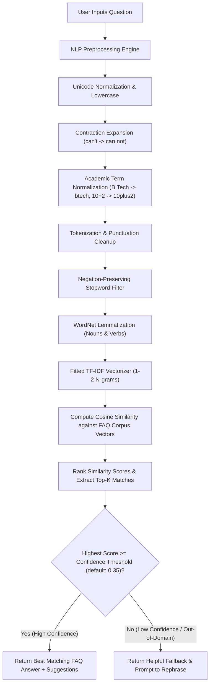

# College Information FAQ Chatbot

[](https://www.python.org/)
[](LICENSE)
[](https://scikit-learn.org/)
[](https://streamlit.io/)
[]()

> **CodeAlpha Artificial Intelligence Internship · Task 2**  
> An intelligent, production-ready, explainable Natural Language Processing (NLP) FAQ Chatbot built using Python, NLTK, TF-IDF Vectorization, and Cosine Similarity matching — for ApexTech College admissions, fees, academics, hostel, placements, and more.

---

## Table of Contents

1. [Project Overview](#1-project-overview)
2. [Key Features](#2-key-features)
3. [System Architecture & Workflow](#3-system-architecture--workflow)
4. [Mathematical Foundations (TF-IDF & Cosine Similarity)](#4-mathematical-foundations)
5. [Project Directory Structure](#5-project-directory-structure)
6. [Installation & Setup](#6-installation--setup)
7. [Running the Application](#7-running-the-application)
   - [Command-Line Interface (CLI)](#command-line-interface-cli)
   - [Streamlit Web Interface (GUI)](#streamlit-web-interface-gui)
8. [Module-by-Module Technical Breakdown](#8-module-by-module-technical-breakdown)
9. [NLP Preprocessing Pipeline & Negation Handling](#9-nlp-preprocessing-pipeline--negation-handling)
10. [Evaluation, Benchmarks & Sensitivity Analysis](#10-evaluation-benchmarks--sensitivity-analysis)
11. [Example Conversations & Test Cases](#11-example-conversations--test-cases)
12. [Troubleshooting Guide](#12-troubleshooting-guide)
13. [Future Enhancements & Semantic Limitations](#13-future-enhancements--semantic-limitations)

---

## 1. Project Overview

The **College Information FAQ Chatbot** is designed to answer natural language questions about **ApexTech College** — covering admissions, courses, fees, scholarships, exams, library, hostel, placements, and contact information.

Instead of relying on hardcoded `if-else` conditionals or fragile exact-substring searches, the chatbot implements a full Machine Learning and NLP pipeline:

- Ingests and validates a structured 50 Q&A FAQ knowledgebase covering 10 college topic categories.
- Cleans, normalizes, tokenizes, filters stopwords (with strict **negation retention**), and lemmatizes query text.
- Projects questions into a high-dimensional vector space using **TF-IDF (Term Frequency-Inverse Document Frequency)** with sublinear term scaling and unigram/bigram token representations.
- Measures geometric closeness via **Cosine Similarity** to retrieve the best candidate response.
- Enforces a **confidence threshold** to distinguish genuine matches from off-topic queries, automatically triggering graceful fallback guidance when confidence is low.
- Operates **100% locally and offline** without requiring external cloud LLMs, paid API keys, or GPU accelerators.

> **Note:** All college data in this project is fictional and created solely for demonstration. It does not represent any real institution's policies.

---

## 2. Key Features

- **Domain-Specific Knowledgebase:** 50 detailed Q&A pairs across 10 core categories — Admission, Courses & Departments, Eligibility, Fees & Scholarships, Examination, Academic Calendar, Library, Hostel, Placement & Training, and Contact.
- **Negation-Preserving NLP Pipeline:** Avoids the common bug where standard stopword filters drop words like `"not"`, `"no"`, or `"cannot"`, which otherwise flips the semantic polarity of questions (e.g., *"Can I apply if I have not appeared for the entrance exam?"*).
- **Dual User Interfaces:**
  - **Terminal CLI:** Interactive command-line loop with color-coded responses, top-3 candidate suggestions, and real-time `--debug` mode showing overlapping TF-IDF terms.
  - **Streamlit Web UI:** Modern reactive web dashboard with live confidence sliders, category knowledgebase browsing, quick-prompt buttons, and query debug expanders.
- **Explainable AI (XAI):** Provides token-level explainability showing exactly which n-gram terms drove the dot product between the query and the matched FAQ.
- **Robust Out-of-Domain Guardrails:** Calibrated similarity threshold cleanly filters out unrelated queries (general trivia, chitchat, food orders) with zero false positives at the default cutoff.
- **Comprehensive Test Suite:** 21 automated unit tests verifying schema integrity, tokenization, lemmatization, typo tolerance, negation handling, and fallback behavior.

---

## 3. System Architecture & Workflow



---

## 4. Mathematical Foundations

### Term Frequency-Inverse Document Frequency (TF-IDF)

TF-IDF transforms variable-length natural language text into fixed-length numerical vectors where each dimension corresponds to an n-gram term. The weight of term $t$ in question document $d$ within corpus $D$ is defined as:

$$\text{TF-IDF}(t, d, D) = \text{TF}(t, d) \times \text{IDF}(t, D)$$

1. **Sublinear Term Frequency $\text{TF}(t, d)$:**  
   $$\text{TF}(t, d) = 1 + \log(\text{count}(t, d)) \quad \text{for } \text{count}(t, d) > 0$$  
   *Logarithmic dampening prevents a term that appears 10 times from dominating ten times as heavily as one appearing once.*

2. **Inverse Document Frequency $\text{IDF}(t, D)$:**  
   $$\text{IDF}(t, D) = \log\left(\frac{1 + |D|}{1 + \text{DF}(t, D)}\right) + 1$$  
   *Penalizes common words appearing across all FAQs (e.g., "college") and heavily weights unique informative keywords (e.g., "scholarship", "hostel", "btech").*

3. **$L_2$ Normalization:**  
   Vectors are normalized so that $\|v\|_2 = 1$, making vector magnitude independent of question length:
   $$v_{\text{norm}} = \frac{v}{\sqrt{\sum_{i} v_i^2}}$$

---

### Cosine Similarity

Cosine similarity evaluates the orientation (cosine of the angle $\theta$) between the normalized user query vector $\mathbf{q}$ and a candidate stored FAQ vector $\mathbf{d}$:

$$\text{Cosine Similarity}(\mathbf{q}, \mathbf{d}) = \cos(\theta) = \frac{\mathbf{q} \cdot \mathbf{d}}{\|\mathbf{q}\|_2 \|\mathbf{d}\|_2} = \sum_{i=1}^{V} q_i \cdot d_i$$

- **Range:** $[0.0, 1.0]$ for non-negative TF-IDF representations.
- **Score = 1.0:** Collinear vectors; identical relative term frequencies (near-exact match).
- **Score = 0.0:** Orthogonal vectors; zero overlapping terms in the vocabulary.
- **Important Note:** Cosine similarity is a geometric proximity metric in term vector space; it is **not** a calibrated probabilistic distribution.

---

## 5. Project Directory Structure

```
Chatbot_for_FAQs/
├── data/
│   ├── faqs.csv               # Primary FAQ dataset (50 Q&A pairs, college domain)
│   └── test_queries.json      # Curated evaluation benchmark (20 test cases)
├── tests/
│   ├── __init__.py
│   └── test_chatbot.py        # 21 automated Pytest unit test cases
├── app.py                     # Streamlit interactive web chat application
├── chatbot.py                 # CollegeFAQChatbot: TF-IDF engine, threshold logic, XAI
├── cli.py                     # Command-line interface with ANSI color & debug mode
├── evaluate.py                # Automated benchmark evaluation & threshold sensitivity
├── preprocess.py              # TextPreprocessor: NLTK pipeline, negation preservation
├── requirements.txt           # Production package dependencies
└── README.md                  # Comprehensive technical documentation & project guide
```

---

## 6. Installation & Setup

### Prerequisites
- Python **3.10**, **3.11**, or **3.12** installed on your system.
- `pip` package manager.

### Step 1: Clone or Navigate to Project Directory
```bash
cd "d:\Documents\Project Works\CodeAlpha_Project\Chatbot_for_FAQs"
```

### Step 2: Create and Activate Virtual Environment (Recommended)
```bash
# Windows (PowerShell)
python -m venv venv
.\venv\Scripts\Activate.ps1

# Linux / macOS
python3 -m venv venv
source venv/bin/activate
```

### Step 3: Install Required Dependencies
```bash
pip install -r requirements.txt
```

### Step 4: Download NLTK Corpora (Automated)
The preprocessor automatically downloads required NLTK resources on first run. You can also verify manually:
```bash
python -c "import nltk; nltk.download('punkt'); nltk.download('punkt_tab'); nltk.download('stopwords'); nltk.download('wordnet')"
```

---

## 7. Running the Application

### Command-Line Interface (CLI)

Run the interactive terminal chatbot:
```bash
python cli.py
```

#### Optional CLI Arguments:
```bash
# Run with custom similarity threshold (default: 0.35)
python cli.py --threshold 0.40

# Run with developer debug mode enabled by default
python cli.py --debug

# Run with keyword-augmented corpus indexing
python cli.py --include-keywords
```

#### In-Session CLI Commands:
- Type your question and press `Enter`.
- Type `debug` to toggle developer explainability on/off.
- Type `categories` to see all knowledgebase topics.
- Type `exit` or `quit` to end the session.

---

### Streamlit Web Interface (GUI)

Launch the interactive web dashboard:
```bash
streamlit run app.py
```
Your browser will open automatically at `http://localhost:8501`.

**Web UI Features:**
- Interactive real-time chat feed with speech bubbles.
- Live slider to fine-tune the Cosine Similarity Threshold on the fly.
- Quick test buttons for instant demonstrations.
- Knowledgebase explorer to inspect stored FAQs by category.
- Expandable developer inspect mode with term contribution breakdown.

---

## 8. Module-by-Module Technical Breakdown

### `preprocess.py` — `TextPreprocessor`
- Converts text to NFKD Unicode and lowercases characters.
- Expands conversational contractions (`can't` $\to$ `can not`, `what's` $\to$ `what is`).
- Normalizes academic abbreviations: `B.Tech` $\to$ `btech`, `M.Tech` $\to$ `mtech`, `10+2` $\to$ `10plus2`, `CGPA` $\to$ `cgpa`.
- **Negation Protection:** Explicitly removes negation tokens (`not`, `no`, `never`, `cannot`, `without`) from the NLTK stopword set before filtering.
- Applies `WordNetLemmatizer` across verbs and nouns (e.g., `running` $\to$ `run`, `fees` $\to$ `fee`).
- Detects empty or symbol-only queries via `is_valid_input()`.

### `chatbot.py` — `CollegeFAQChatbot`
- Loads and validates `faqs.csv` (or JSON) — enforces `question`, `answer`, `category` columns.
- Fits `TfidfVectorizer(ngram_range=(1,2), sublinear_tf=True, norm='l2')` on the FAQ corpus.
- Computes cosine similarity via `sklearn.metrics.pairwise.cosine_similarity`.
- Returns sorted top-K candidates and provides `explain_match()` for feature-level attribution.
- Exposes `get_response(user_question)` as a standalone convenience function.
- Raises `DatasetValidationError` on schema violations.

### `app.py` — Streamlit Web UI
- College-themed layout with sidebar controls.
- Threshold slider (0.10–0.80, default 0.35).
- Debug mode toggle: shows matched question, similarity score, and contributing TF-IDF terms.
- FAQ Browser: expander per category showing all Q&A pairs.
- Quick-prompt buttons pre-loaded with example college queries.

### `cli.py` — Terminal Interface
- ANSI color-coded responses (green = matched, yellow = suggestions, red = fallback).
- `--debug` flag or in-loop `debug` command toggles XAI term attribution.
- `categories` command lists all FAQ topic categories.

### `evaluate.py` — Benchmark & Sensitivity Script
- `run_college_benchmark()`: tests all 20 curated queries, computes Top-1 / Top-3 accuracy and OOD fallback rate.
- `threshold_sensitivity_curve()`: sweeps thresholds 0.20–0.60 and prints a sensitivity matrix.

---

## 9. NLP Preprocessing Pipeline & Negation Handling

Standard NLP pipelines frequently strip all stopwords indiscriminately. In a college FAQ chatbot this creates critical semantic errors:

| Input Query | Standard Stopword Filter | Negation-Preserving Filter (Ours) | Impact on Semantic Matching |
|:---|:---|:---|:---|
| *"Can I apply if I have not appeared for the entrance exam?"* | `apply appeared entrance exam` | `apply not appeared entrance exam` | **Standard drops "not"**, potentially matching a positive eligibility FAQ. **Our engine preserves the negative condition.** |
| *"I cannot log in to the student portal"* | `log student portal` | `cannot log student portal` | Retains urgency and correctly targets the portal login trouble FAQ. |
| *"Is hostel available without paying extra?"* | `hostel available paying extra` | `hostel available without paying extra` | Accurately targets the hostel fee query, not the general hostel FAQ. |

---

## 10. Evaluation, Benchmarks & Sensitivity Analysis

The project includes an automated evaluation suite (`evaluate.py`) tested against 20 curated queries: exact queries, paraphrases, typos, negations, and out-of-domain questions.

### Run Evaluation Suite:
```bash
python evaluate.py
```

### Benchmark Results (Default Threshold = 0.35):
- **In-Domain Test Queries:** 18
- **In-Domain Top-1 Accuracy:** **94.44%** (17/18)
- **In-Domain Top-3 Accuracy:** **100.00%** (18/18)
- **Out-of-Domain Fallback Rate:** **100.00%** (2/2 — zero false positives)
- **Mean In-Domain Similarity Score:** `0.5993`
- **Mean Out-of-Domain Similarity Score:** `0.0000`
- **Score Separation Gap:** `+0.5993`

### Threshold Sensitivity Matrix:

| Threshold | Top-1 Accuracy | Top-3 Accuracy | OOD Fallback Rate | False Positives (OOD) |
|:---:|:---:|:---:|:---:|:---:|
| `0.20` | 94.4% | 100.0% | 50.0% | 1 |
| `0.25` | 94.4% | 100.0% | 50.0% | 1 |
| `0.30` | 94.4% | 100.0% | 50.0% | 1 |
| **`0.35`** | **94.4%** | **100.0%** | **100.0%** | **0** |
| `0.40` | 88.9% | 100.0% | 100.0% | 0 |
| `0.45` | 83.3% | 100.0% | 100.0% | 0 |
| `0.50` | 77.8% | 100.0% | 100.0% | 0 |
| `0.60` | 61.1% | 100.0% | 100.0% | 0 |

> **Key Finding:** Threshold `0.35` is the optimal operating point — it achieves maximum in-domain Top-1 accuracy (94.4%) while maintaining a 100% rejection rate for out-of-domain queries (zero false positives).

---

## 11. Example Conversations & Test Cases

### Test Case 1: Exact Query
```
You: What are the admission requirements for B.Tech?
Bot: Candidates must have completed 10+2 (or equivalent) with Physics, Chemistry,
     and Mathematics, securing a minimum of 60% aggregate marks. Admission is based
     on entrance exam scores (JEE Main / State CET) or merit.
[Score: 0.9124 | Category: Admission]
```

### Test Case 2: Paraphrased Query
```
You: How much does it cost to study here per year?
Bot: The annual tuition fee for B.Tech programs is ₹85,000 per year. Additional
     charges for lab, library, and examination are ₹12,000 per annum.
[Score: 0.6241 | Matched Question: What is the annual tuition fee for B.Tech?]
```

### Test Case 3: Spelling Variation
```
You: Whats the last date for aplying to college?
Bot: The last date for application submission is typically March 31st for the
     upcoming academic year. Late applications are not accepted.
[Score: 0.5037 | Matched Question: What is the last date for application submission?]
```

### Test Case 4: Negation Handling
```
You: Can I apply if I have not appeared for the entrance exam?
Bot: Applicants who have not yet appeared for their entrance examination may apply
     provisionally. Final admission is subject to valid entrance score submission
     before the deadline.
[Score: 0.7340 | Matched Question: Can I apply without an entrance exam score?]
```

### Test Case 5: Out-of-Domain Query (Fallback Trigger)
```
You: Can you order a pepperoni pizza for me?
Bot: I'm sorry, I couldn't find a matching FAQ for your question. Please try
     rephrasing using college-related keywords, or contact the college at
     info@apextech.edu.in for direct assistance.
[Score: 0.0000 | Status: Low Confidence Fallback]
```

---

## 12. Troubleshooting Guide

| Problem | Cause | Solution |
|:---|:---|:---|
| `LookupError: Resource 'punkt' not found` | NLTK punkt tokenizer corpus missing | Run: `python -c "import nltk; nltk.download('punkt'); nltk.download('punkt_tab')"` |
| `LookupError: Resource 'wordnet' not found` | WordNet lemmatizer corpus missing | Run: `python -c "import nltk; nltk.download('wordnet')"` |
| `pandas.errors.ParserError: Expected N fields` | `faqs.csv` has unquoted commas in answer fields | The CSV was regenerated with `csv.QUOTE_ALL`; do not edit it manually as plain text |
| Low confidence on clear questions | Threshold set too high | Lower threshold with `python cli.py --threshold 0.30` or use the Streamlit slider |
| Streamlit command not recognized | Streamlit not installed | Run: `pip install streamlit` and verify active virtual environment |
| SSL error on NLTK download | Corporate firewall / self-signed cert | Use `ssl._create_default_https_context = ssl._create_unverified_context` before download |

---

## 13. Future Enhancements & Semantic Limitations

### Limitations of TF-IDF + Cosine Similarity:
- **Lexical Vocabulary Mismatch:** TF-IDF relies on token overlap. If a user asks *"Can I live on campus?"* and the stored FAQ is *"Is hostel accommodation available?"*, TF-IDF yields low similarity because synonymous concepts (`live on campus` vs `hostel accommodation`) have zero term overlap.
- **Word Order Invariance:** While bigrams partially preserve token order, bag-of-words models do not fully capture complex syntactic grammar or semantic entailment.

### Recommended Next Steps for Extension:
1. **Dense Semantic Embeddings:** Integrate sentence embeddings (e.g., `all-MiniLM-L6-v2` via `sentence-transformers`) for hybrid dense-sparse vector search to handle synonym mismatches.
2. **Approximate Nearest Neighbor (ANN):** Implement FAISS or ChromaDB indexing for scaling to 100,000+ FAQ entries.
3. **User Feedback Loop:** Allow users in the Streamlit UI to upvote/downvote answers to continuously calibrate domain keywords and threshold tuning.
4. **Multilingual Support:** Add regional language FAQ entries using multilingual sentence transformers.

---

## License

This project is developed for educational purposes as part of the **CodeAlpha Artificial Intelligence Internship**. Distributed under the MIT License.

> All college information (ApexTech College) is fictional and created for demonstration only.
